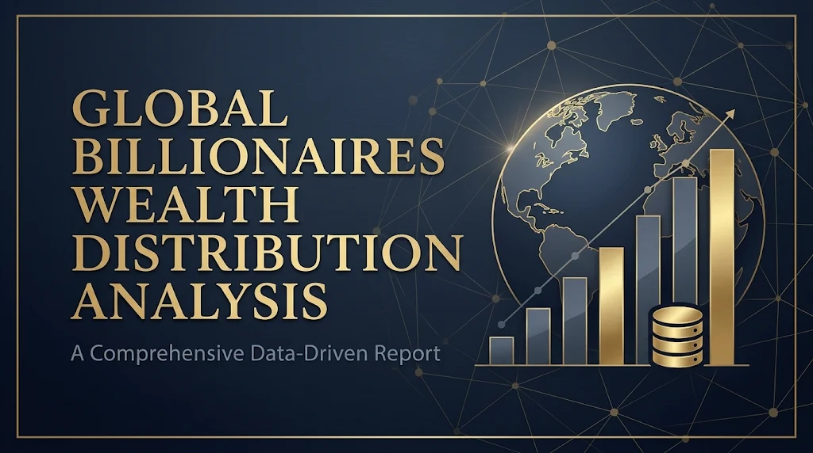

# The-Top-200-Richest-World-s-Billionaires-Wealth-Analysis-By-Amaglo-Emmanuel
This report captures essential information about the top 200 billionaires, offering insights into their financial standing, age, industry, and more.

## **INTRODUCTION**
This report provides a comprehensive data-driven analysis of wealth distribution, regional concentrations, industry dynamics, and demographic trends among the world’s 200 richest individuals. Utilizing SQLite database queries and descriptive visualizations, this project evaluates the structural mechanisms underlying extreme wealth creation.

## **ABOUT DATASET** 
The Top 200 Richest World's Billionaires Dataset provides a detailed overview of the wealthiest
individuals globally, according to the Forbes list. This dataset captures essential information
about the top 200 billionaires, offering insights into their financial standing, age, industry, and
more. It is a valuable resource for analyzing trends in wealth distribution, industry dominance,
and the demographics of the world's richest people.
*Data Source*: [click here](https://docs.google.com/spreadsheets/d/1CYEHRdBF_yJ3ztRclXZl_x_W5mh2ob2D3_FWbhdxf_Y/edit?usp=sharing)

## **VISUALIZATION**
Utilizing SQLite database queries, this project evaluates the structural mechanisms underlying extreme wealth creation in the world.

 
## **DISCUSSION**
With the use of SQLite, answers to the analytical questions were solved and displayed with their respective visuals in the Visaulization section.

## *1: Retrieve the 20 Richest Billionaires*
Bernard Arnault & family, Elon Musk, and Jeff Bezos represented the top of the overall leaderboard respectively.

## *2: Identify the Five Youngest Billionaires*
 The youngest Billionaires were retrieved and was led by Mark Mateschitz (31) and Lukas Walton (37).

## *3: Calculate the Average Age and Average Net Worth*
An average age of 69.38 years and an average net worth of $31.84 billion were recorded.

## *4: Identify the Five Most Represented Countries*
Country representation among the top 200, highlighted that the massive dominance was the United States with 79 billionaires.

## *5: Calculate the Combined Net Worth of Billionaires from Each Country*
The cumulative wealth concentrations of the top 10 countries were calculated, with the United States surpassing $3 Trillion in total wealth.

## *6: Identify the Five Industries with the Highest Number of Billionaires*
Ranking the top industries by volume of Billionaires, Technology (40) and Finance & Investments (32) was the primary wealth drivers.

## *7: Find Countries with At Least Five Billionaires*
Countries having fewer than five representatives, showcased the 8 nations that pass the threshold.

## *8: Calculate the Total Wealth of Billionaires Younger Than 50*
Wealth distribution across age groups was analyzed. Billionaires under 50 account for $508.3 Billion (8.0%) of total net worth across the dataset.

## *9: Identify Billionaires Whose Net Worth Exceeds the Overall Average Net Worth*
It was seen that only 53 billionaires exceed the overall dataset mean of $31.84 billion, leaving 147 individuals below the average.

## *10: Identify the Industry with the Highest Average Net Worth*
Though Technology has the highest total count, Telecom yielded the highest average net worth per billionaire at $102.00 Billion.

## **KEY ANALYTICAL TAKEAWAYS**

*Geographic Hegemony*: The United States holds dominant market share in ultra-high-net-worth individuals, representing 39.5% of the total dataset (79 billionaires) and accumulating over $3.14 Trillion in total wealth.

*Industry Performance*: Technology is the primary incubator for elite wealth creation by headcount (40 individuals), whereas Telecom boasts the highest average wealth per billionaire ($102.00 Billion).

*Demographic Maturity*: The average age across the top 200 is 69.38 years. Individuals under age 50 command only 8.0% ($508.3 Billion) of total wealth, emphasizing the role of compounding capital and enterprise longevity.

*Pareto Distribution*: Wealth is heavily skewed toward the top. Only 53 billionaires exceed the dataset average net worth of $31.84 Billion, while 147 sit below the mean.

